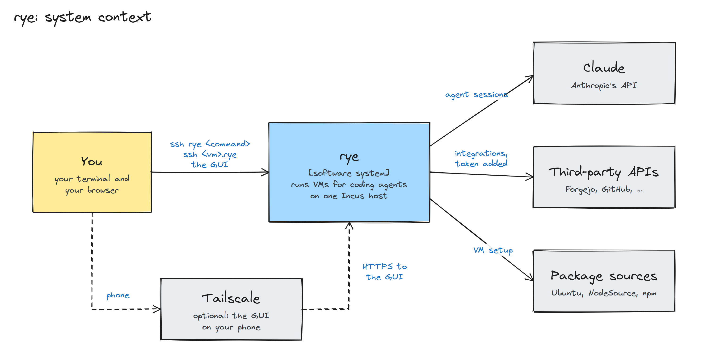
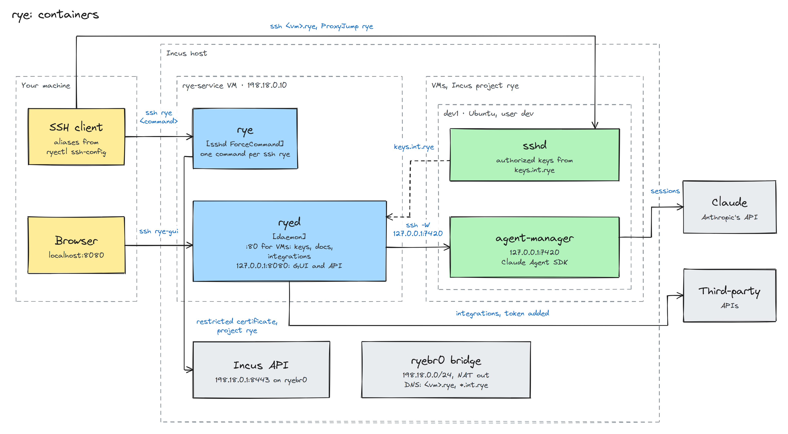
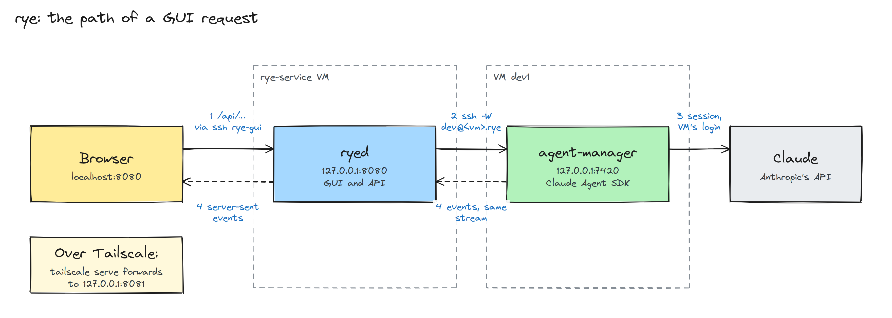

# Architecture

rye runs on one Incus host. `make up` creates these on it, through `ryectl` and the Incus admin socket:

- the `ryebr0` bridge, on 198.18.0.0/24 with NAT to the internet.
- the restricted Incus project `rye`, for the VMs.
- the service VM `rye-service` at 198.18.0.10, in the `default` project.

The programs inside the service VM and a VM, and the connections between them:

## The service VM
The service VM manages the VMs. It connects to the Incus API at the host's bridge address on port 8443. The service
VM stores its client certificate. Incus restricts that certificate to the `rye` project.

It runs two programs.

`rye` is the sshd `ForceCommand` of the `rye` user. Every `ssh rye <command>` runs one `rye` command and exits. sshd
allows key logins for the `rye` user. It allows port forwarding only to the GUI port and to port 22 of any host the
service VM reaches.

`ryed` listens on two ports:

- `:80` on the bridge, for VMs. Requests to `keys.int.rye` return the keys that VMs' sshd accepts.
  `docs.int.rye` serves rye's docs and code at the deployed commit, described in
  [Docs served to VMs](../reference/docs-site.md).
  Every other `<name>.int.rye` is an integration.
- `127.0.0.1:8080`, for the GUI and its API. After `make tailscale`, `127.0.0.1:8081` serves the same API to
  `tailscale serve`.

## VMs
Each VM runs Ubuntu with a `dev` user. Its sshd requests the authorized keys from `http://keys.int.rye/`. They are
the keys `make up` authorized and the service VM's own key.

The bridge's DNS resolves `<vm>.rye` to each VM and every `*.int.rye` name to the service VM. Your SSH client
connects to `<vm>.rye` through the service VM with `ProxyJump rye`.

## The path of a GUI request

1. The browser calls `/api/...` on `localhost:8080`. `ssh rye-gui` forwards it to `ryed`.
2. `ryed` opens `ssh -W 127.0.0.1:7420 dev@<vm>.rye` with the service VM's key.
3. That stream connects to `agent-manager` in the VM, which runs the session with the Agent SDK and the VM's Claude
   login.
4. `agent-manager` sends events back over the same stream. `ryed` sends them to the browser as server-sent events.

Over Tailscale, `tailscale serve` on the service VM receives the request in step 1 and forwards it to `127.0.0.1:8081`.

## The steps of an agent-manager install
1. `ssh rye agent-manager install <vm>` runs `rye` on the service VM. The VM must be running. `rye` reaches it through
   the Incus API with the restricted client certificate.
2. As root, it adds NodeSource's `node_26.x` apt repository and installs Node.js when the VM lacks that release line.
3. It turns on systemd linger for `dev` and waits for `dev`'s user manager.
4. It writes agent-manager's files, which `rye` holds, to the VM through the Incus guest agent.
5. As `dev`, it unpacks the files beside the installed version and runs `install.sh`. That script installs the
   dependencies from the lockfile with pnpm, then stops agent-manager, swaps the new files in, writes rye's
   instructions for Claude, starts agent-manager's user unit and waits until it listens. If the new version doesn't
   listen, it puts the previous version back.
6. As root, it links `/usr/local/bin/claude` to the `claude` CLI that the Agent SDK bundles.
7. `rye` marks the VM in its Incus config as having agent-manager. The mark lasts until the VM is removed.

## The path of an integration request
1. A VM calls `http://<name>.int.rye/<path>`. The name resolves to the service VM.
2. `ryed` finds the DHCP lease for the request's source address, then the VM with the lease's hardware address.
   MAC and IP filtering on each VM's network interface blocks a VM from using another VM's addresses.
3. If the integration is attached to that VM, `ryed` forwards the request to the integration's URL with its
   credential. Otherwise it returns `403`.
4. If the integration's URL host is `<vm>.rye`, `ryed` opens an SSH connection to that VM as `dev`. It forwards the
   request to `127.0.0.1` on the URL's port.
